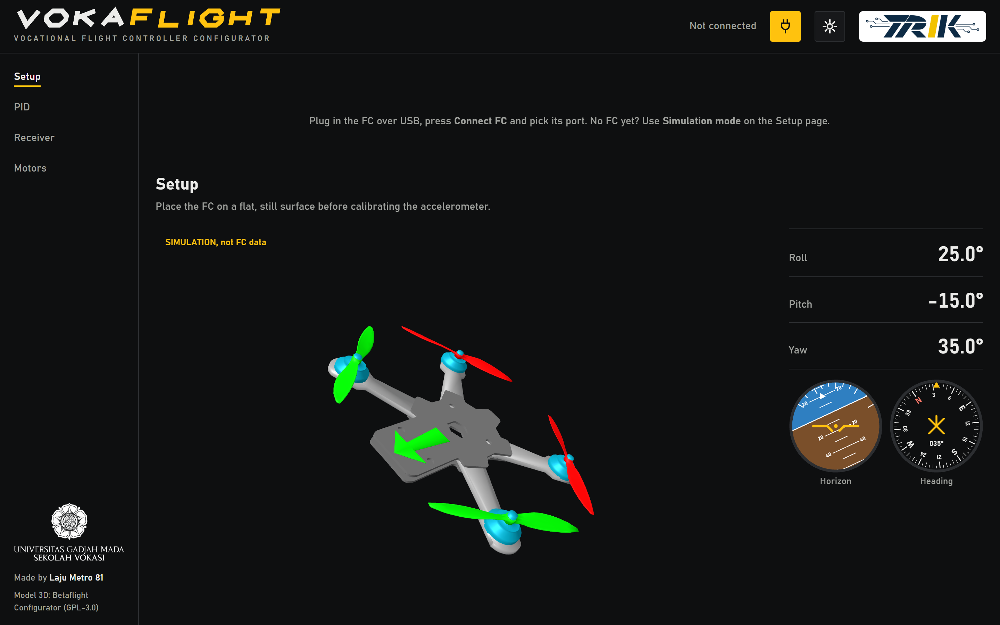
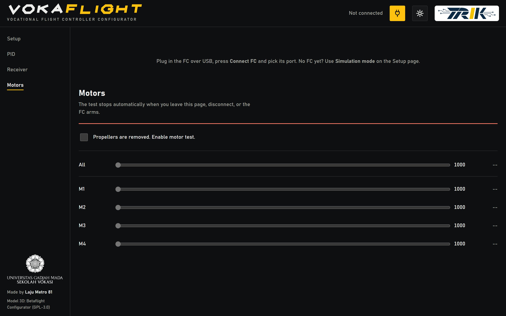

# VOKAFLIGHT

Web-based flight controller configurator. Open `vokaflight.html` in desktop Chrome or Edge, plug the FC in over USB, and set attitude, PID, receiver, and motors from one page. No install and no server: Web Serial and three.js run straight from the local file.



## Screens

| Setup, light mode | PID | Receiver |
| --- | --- | --- |
|  |  |  |

| Motors | Phone layout |
| --- | --- |
|  |  |

## Pages

- **Setup**: Betaflight quad X model in 3D, roll/pitch/yaw readout, artificial horizon, compass, accelerometer calibration, yaw zero, and the FC log.
- **PID**: P, I, D table for roll, pitch, and yaw. Send to RAM, save to flash, or read back from the FC.
- **Receiver**: eight channels with bars and a 1500 center line.
- **Motors**: master and four motor sliders, gated behind a "propellers removed" checkbox.

Without an FC, turn on **Simulation mode** on the Setup page. Angles come from the sliders, not from a sensor.

## Running it

1. Download this repo, or `git clone https://github.com/lajumetro/vokaflight.git`
2. Open `vokaflight.html` in desktop Chrome or Edge
3. Press the plug button in the top right and pick the FC port
4. Other browsers (Firefox, Safari, mobile) have no Web Serial. The page says so, and simulation mode still works.

## Firmware

| Folder | Contents |
| --- | --- |
| `firmware/vokalink_demo` | Simulated attitude and RC data, for testing the UI without a sensor |
| `firmware/vokalink_mpu6050` | MPU6050 over I2C, complementary filter, offsets stored in flash |

MPU6050 wiring: VCC 3V3, GND, SDA GPIO21, SCL GPIO22, AD0 to GND (address 0x68). Address 0x69 is detected too. Keep the board flat and still for about a second at boot so the gyro can calibrate.

The text protocol between FC and page lives in `firmware/vokalink_demo/vokalink.h`: one command per line at 115200 baud.

## Layout

```
vokaflight.html          configurator page (HTML, CSS, and JS in one file)
vendor/                  three.js, GLTFLoader, quad_x.gltf model
firmware/                ESP32 firmware (Arduino)
resource/                TRIK and UGM SV logos
docs/                    screenshots for this README
```

## Credits

- Quad X 3D model from Betaflight Configurator, GPL-3.0. License text in `vendor/quad_x.LICENSE-GPL-3.0.txt`.
- three.js and GLTFLoader, MIT. License text in `vendor/three.LICENSE`.
- Built by Laju Metro 81, Vocational School, Universitas Gadjah Mada.

This repo has no license file of its own yet.
