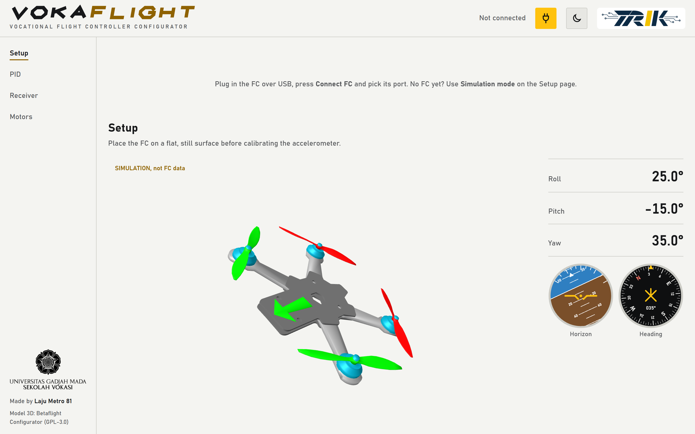
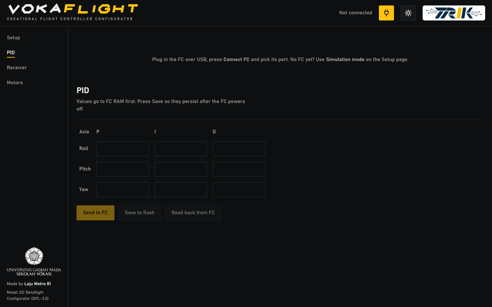
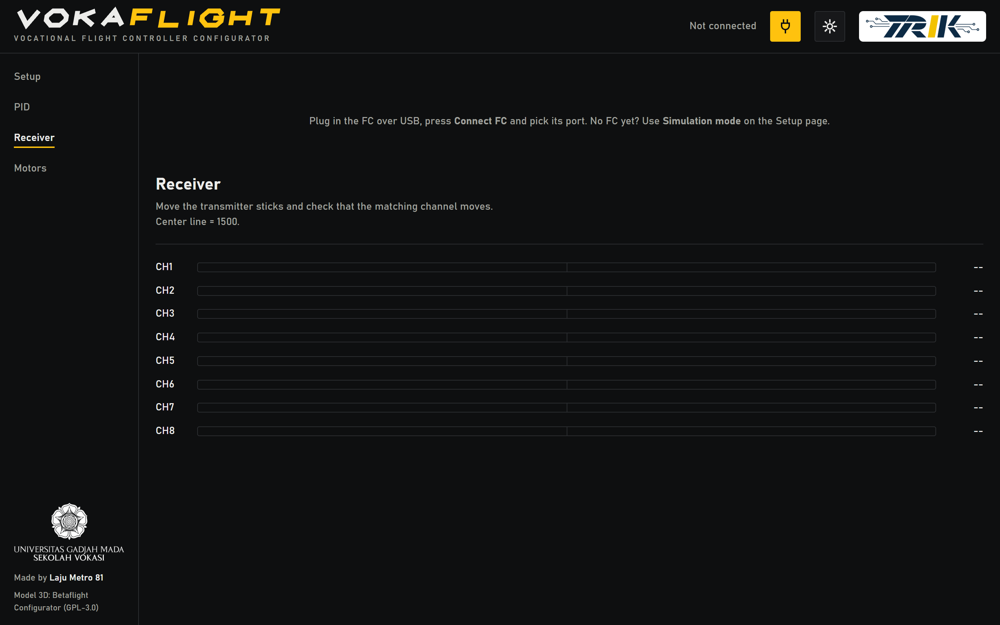
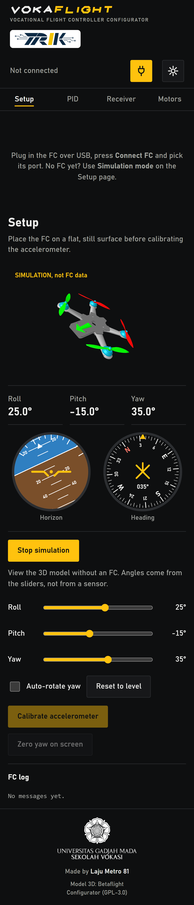

# VOKAFLIGHT

Configurator flight controller berbasis halaman web. Buka `vokaflight.html` di Chrome atau Edge desktop, sambungkan FC lewat USB, lalu atur sikap, PID, receiver, dan motor dari satu halaman. Tanpa instalasi dan tanpa server: Web Serial dan three.js jalan langsung dari file lokal.


## Tampilan

| Setup, mode terang | PID | Receiver |
| --- | --- | --- |
|  |  |  |

| Motors | Tampilan ponsel |
| --- | --- |
|  |  |

## Halaman

- **Setup**: model 3D quad X dari Betaflight, sudut roll/pitch/yaw, horizon buatan, kompas, kalibrasi akselerometer, zero yaw, dan log FC.
- **PID**: tabel P, I, D untuk roll, pitch, dan yaw. Kirim ke RAM, simpan ke flash, atau baca ulang dari FC.
- **Receiver**: delapan kanal dengan bar dan garis tengah 1500.
- **Motors**: slider master dan empat motor, dengan kunci "propeller dilepas" sebelum tes aktif.

Tanpa FC, aktifkan **Simulation mode** di halaman Setup. Sudut datang dari slider, bukan dari sensor.

## Menjalankan

1. Unduh repo ini, atau `git clone https://github.com/lajumetro/vokaflight.git`
2. Buka `vokaflight.html` di Chrome atau Edge desktop
3. Tekan tombol colokan di kanan atas, pilih port FC
4. Perangkat lain (Firefox, Safari, ponsel) tidak punya Web Serial. Halaman akan menampilkan pesan, dan mode simulasi tetap jalan.

## Firmware

| Folder | Isi |
| --- | --- |
| `firmware/vokalink_demo` | Data sikap dan RC disimulasikan, untuk menguji UI tanpa sensor |
| `firmware/vokalink_mpu6050` | MPU6050 lewat I2C, complementary filter, offset tersimpan di flash |

Wiring MPU6050: VCC 3V3, GND, SDA GPIO21, SCL GPIO22, AD0 ke GND (alamat 0x68). Alamat 0x69 juga dideteksi otomatis. Diamkan board rata sekitar satu detik saat boot untuk kalibrasi gyro.

Protokol serial teks antara FC dan halaman ada di `firmware/vokalink_demo/vokalink.h`, satu perintah per baris pada 115200 baud.

## Struktur

```
vokaflight.html          halaman configurator (HTML, CSS, dan JS dalam satu file)
vendor/                  three.js, GLTFLoader, model quad_x.gltf
firmware/                firmware ESP32 (Arduino)
resource/                logo TRIK dan UGM SV
docs/                    tangkapan layar untuk README
```

## Kredit

- Model 3D quad X dari Betaflight Configurator, GPL-3.0. Teks lisensi di `vendor/quad_x.LICENSE-GPL-3.0.txt`.
- three.js dan GLTFLoader, MIT. Teks lisensi di `vendor/three.LICENSE`.
- Dibuat oleh Laju Metro 81, Sekolah Vokasi Universitas Gadjah Mada.

Repo ini belum punya file lisensi sendiri.
